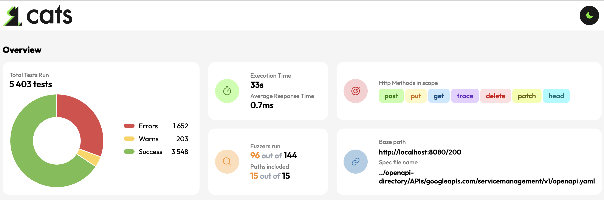
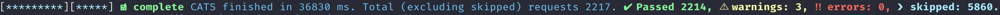

<p align="center">
  
  
</p>
<p align="center">


[](https://github.com/Endava/cats/pulse)

[](https://opensource.org/licenses/Apache-2.0)
[](https://openjdk.org)
[](https://www.graalvm.org)
[](https://sonarcloud.io/dashboard?id=cats)
[](https://sonarcloud.io/dashboard?id=cats)
[](https://sonarcloud.io/dashboard?id=cats)
[](https://sonarcloud.io/dashboard?id=cats)

</p>

> CATS documentation is available at [https://endava.github.io/cats/](https://endava.github.io/cats/)

**REST API fuzzer and negative testing tool. Run thousands of self-healing API tests within minutes with no coding effort!**

- **Comprehensive**: tests are generated automatically based on a large number scenarios and cover **every** field and header
- **Intelligent**: tests are generated based on data types and constraints; each Fuzzer has specific expectations depending on the scenario under test
- **Highly Configurable**: high amount of customization: you can filter specific Fuzzers, HTTP response codes, HTTP methods, request paths, provide business context and a lot more
- **Self-Healing**: as tests are generated, any OpenAPI spec change is picked up automatically
- **Simple to Learn**: flat learning curve, with intuitive configuration and syntax
- **Fast**: automatic process for write, run and report tests which covers thousands of scenarios within minutes

<p align="center"></p>

> Short on time? Check out the [1-minute Quick Start Guide](https://endava.github.io/cats/docs/intro)!

# Overview
By using a simple and minimal syntax, with a flat learning curve, CATS (**C**ontract **A**PI **T**esting and **S**ecurity) enables you to generate thousands of API tests within minutes with **no coding effort**.
All tests are **generated, run and reported automatically** based on a pre-defined set of **160+ Fuzzers** (plus 31 random mutators for continuous fuzzing).
The Fuzzers cover a wide range of boundary testing, type coercion, injection, and negative scenarios: from large Unicode and control-character payloads to context-dependent values derived from request data types and constraints, as well as stateful checks for IDOR, `PUT` idempotency, update-read consistency, conditional `ETag` handling, deleted resource availability, and sensitive data exposure.

Out of the box, CATS orders producer `POST` paths before dependent operations, executes fuzzers in breadth-first waves across paths, **reuses identifiers and baselines learned** from `2XX` responses in subsequent requests, postpones `HappyPath` `DELETE` calls until the end of the run, and validates responses against OpenAPI 3.0 and 3.1 schemas. You can also write end-to-end functional tests in YAML using `cats run`.

## Quick start

```shell
# Run the full suite against an OpenAPI contract
cats -c openapi.yml -s http://localhost:8080

# Run a built-in profile (quick, security, compliance, ci, coverage, crash, type-coercion, health-check)
cats -c openapi.yml -s http://localhost:8080 --profile quick

# Run for a fixed time budget, continuing with random mutations if deterministic fuzzers finish early, and enforce a quality gate
cats -c openapi.yml -s http://localhost:8080 --stopAfterTimeInSec 60 --fillTimeBudget --qualityGate "errors<1"

# Lint the OpenAPI contract
cats lint -c openapi.yml

# Inspect dependency-ordered paths or explain a profile/fuzzer
cats list --paths --executionOrder -c openapi.yml
cats explain --type profile security

# Replay a test case or print the equivalent curl command
cats replay Test12
cats replay Test12 --curl
```

## HTML Report

<div align="center">
  
</div>

## Command Line

<div align="center">
  
</div>

## Terminal interface

Use `--tui` on a normal fuzzing command to follow execution and inspect results without leaving the terminal:

```shell
cats --contract openapi.yml --server http://localhost:8080 --tui
```

The overview shows Paths, Run configuration, Response time, HTTP Response Codes, Success/Warnings/Errors, and Fuzzers run using the same terminology as the CLI and HTML report. The fuzzer table uses all available terminal rows; use `j`/`k` or Page Up/Page Down to browse it when the complete list does not fit. Press `2` for Execution Details, `3` for the Execution summary and Quality gate result, `4` for Execution Details by Result Reason, `5` for Paths included, or `6` for executed tests sorted by Response Time. Result Reason and Path rows open their matching tests with Enter.

Use the arrow keys or `j`/`k` to select a test, and press Enter to inspect its request, response, result, trace, and replay command in a full-screen detail view. Press `/` in the test list to search test IDs, fuzzers, paths, scenarios, result reasons, methods, results, and response codes. `a`, `e`, `w`, `s`, and `i` filter all, error, warning, successful, and skipped results. Esc first clears an active search and otherwise returns to the previous screen; `1` opens the overview.

Press `q` to leave the interface. During an active run this requests cancellation, finishes the current test where possible, preserves results already written, and exits with status `130`. After execution has finished, `q` exits normally.

The TUI requires an interactive terminal of at least 80 columns by 24 rows and cannot be combined with `--dryRun`. It is available for OpenAPI-backed fuzzing commands; the standalone `template` command continues to use normal CLI output. The TUI retains the most recent 10,000 test details by default; use `--tuiMaxResults` to choose a different positive limit. Aggregate statistics continue to cover the complete run when older details are discarded.

# Tutorials on how to use CATS

This is a list of articles with step-by-step guides on how to use CATS:
* [Testing the GitHub API with CATS](https://ludovicianul.github.io/posts/github-api-testing/)
* [How to write self-healing functional tests with no coding effort](https://ludovicianul.github.io/posts/self-healing-api-tests/)

# Some bugs found by CATS

- https://github.com/hashicorp/vault/issues/13274 | https://github.com/hashicorp/vault/issues/13273
- https://github.com/hashicorp/vault/issues/13225 | https://github.com/hashicorp/vault/issues/13232
- https://github.com/go-gitea/gitea/issues/19397  | https://github.com/go-gitea/gitea/issues/19398
- https://github.com/go-gitea/gitea/issues/19399

# Installation

## Homebrew

```shell
> brew tap endava/tap
> brew install cats
```

## Manual
CATS is bundled both as an executable JAR or a native binary. The native binaries do not need Java installed. 

After downloading your OS native binary, you can add it to PATH so that you can execute it as any other command line tool:

```shell
sudo cp cats /usr/local/bin/cats
```

You can enable shell completion in `bash` or `zsh` directly from the binary:

```shell
source <(cats generate-completion)
```

Alternatively, you can source the [cats_autocomplete](cats_autocomplete) script from the repository:

```shell
source cats_autocomplete
```

To make completion persistent, add the command to `.zshrc` or `.bashrc`.

There is no native binary for Windows, but you can use the uberjar version. This requires Java 25+ to be installed.

You can run it as `java -jar cats.jar`.

Head to the releases page to download the latest version: [https://github.com/Endava/cats/releases](https://github.com/Endava/cats/releases).

## Build from sources

You can build CATS from sources on your local machine. You need [Java 25](https://sdkman.io/jdks). Maven is already bundled.

> Before running the first build, please make sure you run `./mvnw clean`. CATS uses patched forks of [OkHttp](https://square.github.io/okhttp/) (`com.squareup.okhttp3:okhttp:5.5.0-CATS`) and [Swagger Parser](https://github.com/swagger-api/swagger-parser) (`io.swagger.parser.v3:swagger-parser-v3:2.1.49-CATS`), which Maven installs locally from `lib/` without overriding official dependency versions.

You can use the following Maven command to build the project as an uberjar:

`./mvnw package -Dquarkus.package.jar.type=uber-jar -DskipTests`


You will end up with a `cats-runner.jar` in the `target` folder. You can run it with `java -jar cats-runner.jar ...`.

You can also build native images using a [GraalVM Java version](https://www.graalvm.org/).

`./mvnw package -Pnative`

### Notes on Unit Tests

You may see some `error` log messages while running the Unit Tests. Those are expected behaviour for testing the negative scenarios of the Fuzzers.

# Runtime defaults

## TLS

CATS verifies server certificates and hostnames by default. For trusted test environments using self-signed certificates, verification can be disabled explicitly with `--insecure`.

For mutual TLS, use `--sslKeystore`, `--sslKeystorePwd` and `--sslKeyPwd`. If `--sslKeyPwd` is omitted, CATS uses the keystore password for the private key.

## Secrets, authentication, and replay

CATS masks authentication headers and sensitive query parameters in reports by default, replacing request values with replayable `$$EnvironmentVariable` placeholders. It creates `replay.env.example` without secret values in the directory where CATS is run.

CATS automatically loads `./.env` when present. Use `--envFile path/to/cats.env` to select a different file or `--noEnvFile` to disable dotenv loading in normal, random, functional, template and replay commands. Process environment variables take precedence over dotenv values. Use `--showSecrets` only when unmasked report and console output is explicitly required.

Web Fuzzing Commons authentication files are supported via `--wfcAuth` and `--wfcAuthName`. When `--wfcAuthName` is omitted and the file defines multiple entries, CATS starts with the first entry and switches to subsequent entries if baseline requests return HTTP `401` or `403`.

## Response safety budgets

CATS cancels calls that exceed `--callTimeout`, which defaults to 20 seconds, and captures at most `--maxResponseBytes`, which defaults to 10 MiB of the decompressed response body. Set either option to `0` to disable its limit. Truncated responses retain their status and headers, skip full-body validation, and are reported with a dedicated warning.

When `--dryRun` is enabled, CATS parses local configuration and calculates test counts without invoking target services, WFC login endpoints, authentication scripts, update checks, or report writers.

# Contributing
Please refer to [CONTRIBUTING.md](CONTRIBUTING.md). 
