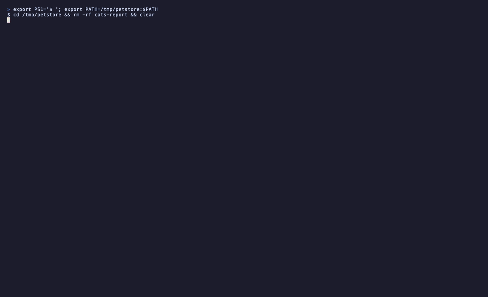
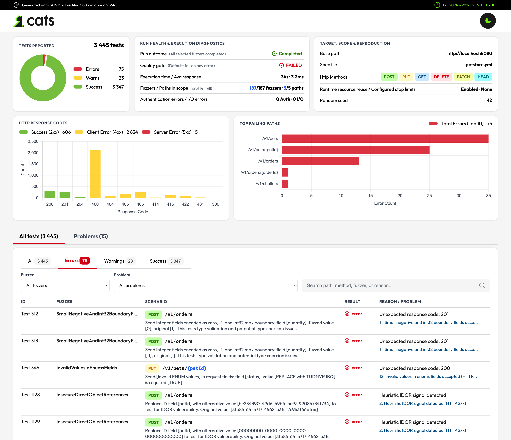
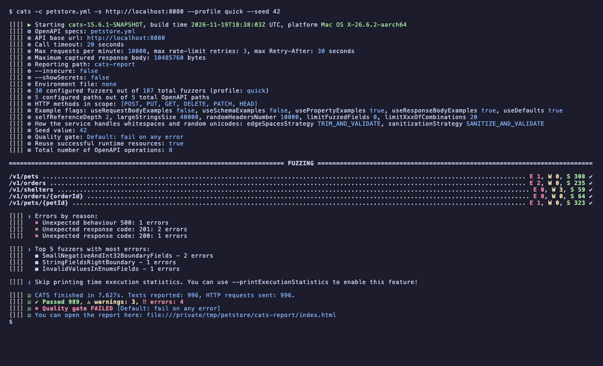
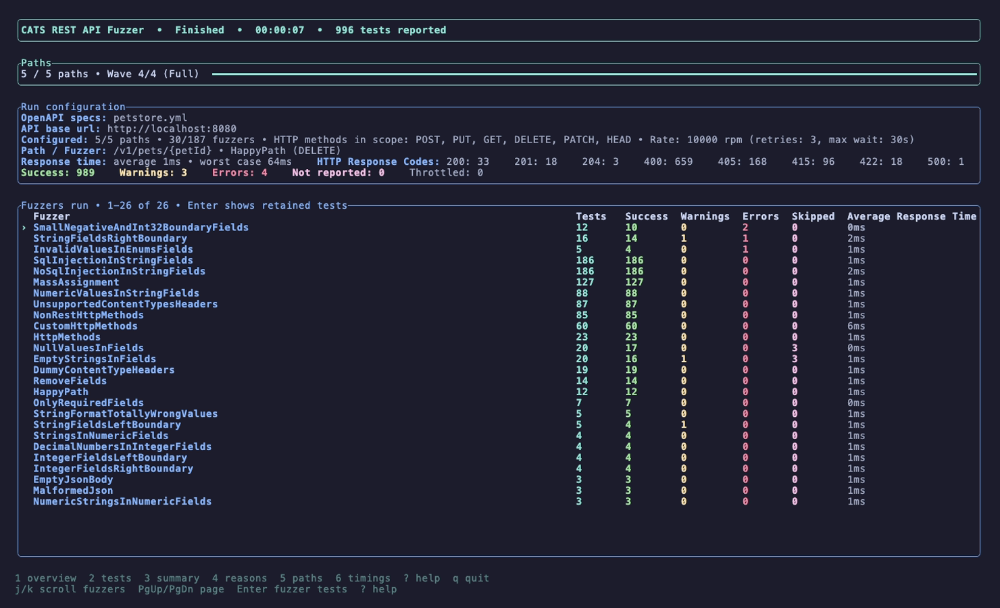

<p align="center">
  
  
</p>
<p align="center">

[](https://opensource.org/licenses/Apache-2.0)
[](https://openjdk.org)
[](https://www.graalvm.org)
[](https://sonarcloud.io/dashboard?id=cats)
[](https://sonarcloud.io/dashboard?id=cats)

</p>

**CATS** (**C**ontract **A**PI **T**esting and **S**ecurity) is an OpenAPI fuzzer, contract linter, and negative testing CLI for REST APIs. Given an OpenAPI 3.0 or 3.1 specification, it generates, executes, and verifies thousands of HTTP test cases without writing test code.

Full documentation: [https://endava.github.io/cats/](https://endava.github.io/cats/) | [Quick Start Guide](https://endava.github.io/cats/docs/intro)

- **Contract-driven generation**: Builds payloads, headers, query parameters, and path variables directly from OpenAPI data types, formats, regex patterns, enums, and numeric/string bounds.
- **Stateful execution order**: Runs producer `POST` endpoints before dependent operations, captures resource IDs and `ETag` baselines from `2XX` responses for reuse in subsequent requests, and defers `DELETE` calls until the end of the run.
- **270+ fuzzers, linters, and mutators**: Covers boundary values, type coercion, malformed JSON, Unicode/control-character handling, injection probes, authentication bypass, IDOR, `PUT`/`PATCH` semantics, deleted-resource checks, and 44 random mutators for continuous fuzzing.
- **Reproducible findings**: Clusters failures by root cause, masks credentials as `$$ENV_VAR` placeholders, exports standalone `curl` reproducers, and compares runs against baselines in CI.

<div align="center">
  
</div>

## Installation

### Homebrew (macOS / Linux)

```shell
brew tap endava/tap
brew install cats
```

### Native Binary or Uber-JAR

Download the prebuilt native binary (Linux / macOS, no JVM required) or `cats.jar` (requires Java 25+) from the [GitHub Releases](https://github.com/Endava/cats/releases) page:

```shell
# Install the native binary on your PATH
sudo cp cats /usr/local/bin/cats

# Or run the uber-JAR with Java 25+
java -jar cats.jar --help
```

Enable shell completion for `bash` or `zsh`:

```shell
source <(cats generate-completion)
```

## Quick Start

```shell
# Run the full fuzzer suite against an OpenAPI contract
cats -c openapi.yml -s http://localhost:8080

# Run a built-in profile (quick, security, compliance, ci, coverage, crash, type-coercion, health-check)
cats -c openapi.yml -s http://localhost:8080 --profile quick

# Run in blackbox mode (fail only on 5XX crashes and confirmed security findings) with an auth header from $TOKEN
cats -c openapi.yml -s http://localhost:8080 -b -k -H "Authorization=Bearer $$TOKEN"

# Enforce a 60-second budget (continuing with random mutations if deterministic fuzzers finish early) and a CI gate
cats -c openapi.yml -s http://localhost:8080 --stopAfterTimeInSec 60 --fillTimeBudget --qualityGate "errors<1"

# Lint the OpenAPI contract without calling a target server
cats lint -c openapi.yml

# Group report failures into root-cause problems or compare against a previous baseline
cats triage -r cats-report
cats compare -b baseline-report -t cats-report

# Replay a recorded test case or print its standalone curl command
cats replay Test12
cats replay Test12 --curl
```

## CLI Commands

| Command | Purpose |
| :--- | :--- |
| `cats -c <spec> -s <url>` | Run deterministic fuzzers against an OpenAPI contract |
| `cats smoke` | Run a fast baseline reachability check across contract operations |
| `cats analyze` | Inspect contract readiness, unresolved parameters, and runtime hints before fuzzing |
| `cats lint` | Lint an OpenAPI contract for structural, schema, and security-definition issues |
| `cats triage` | Cluster report failures into root-cause problems and export `curl` reproducers |
| `cats compare` | Compare two reports (`NEW`, `FIXED`, `UNCHANGED`) and fail CI on regressions |
| `cats replay` | Re-execute saved `Test*.json` cases (`--stateful` for fresh IDs) or output `--curl` commands |
| `cats random` | Run continuous mutation-based fuzzing for a time budget or request count |
| `cats run` | Execute declarative YAML functional tests and multi-step API flows |
| `cats template` | Fuzz raw HTTP request templates without an OpenAPI specification |
| `cats list` / `cats explain` | List and inspect fuzzers, linters, profiles, mutators, formats, paths, and error reasons |
| `cats stats` / `cats validate` | Show OpenAPI contract metrics or validate specification syntax |
| `cats init` | Scaffold project configuration files or install AI agent skills (`--skills`) |

## HTML Report

Each run generates an interactive HTML report (`cats-report/index.html`) with run health diagnostics, HTTP response code distributions, top failing paths, root-cause problem clusters, and full request/response payloads with copyable `curl` commands.

<div align="center">
  
</div>

## Command Line Output

<div align="center">
  
</div>

## Terminal Interface (`--tui`)

Add `--tui` to any OpenAPI fuzzing run to monitor execution and inspect test cases interactively in the terminal:

```shell
cats -c openapi.yml -s http://localhost:8080 --tui
```

<div align="center">
  
</div>

- Switch views with `1` (Overview), `2` (Execution Details), `3` (Summary & Quality Gate), `4` (By Result Reason), `5` (Paths), and `6` (Response Times).
- Navigate rows with arrow keys or `j`/`k`, press `Enter` to open the full request/response trace and `curl` command, and press `/` to search or `a`/`e`/`w`/`s`/`i` to filter by status.
- Press `q` to exit (during an active run, `q` cancels execution cleanly, preserves recorded results, and exits with status `130`).

## Report Triage and Baseline Comparison

### Triage (`cats triage`)

`cats triage -r cats-report` groups individual failing test cases into deduplicated problem clusters with observed behavior, sample evidence, and next-step checks:

```shell
# Print clustered error problems to the console (add -w / --include-warnings to include warnings, or -j for JSON)
cats triage -r cats-report
cats triage -r cats-report --include-warnings

# Export standalone curl reproducers or re-verify live against the server
cats triage -r cats-report --export-reproducers reproducers.sh
cats triage -r cats-report --verify
```

### Baseline Comparison (`cats compare`)

Compare two report folders (or their `cats-summary-report.json` files) to gate CI pipelines on newly introduced regressions:

```shell
cats compare -b baseline-report -t current-report -j
```

You can also pass `--baseline <report>` directly during a fuzzing run. Exit codes are `0` (no regression), `1` (new error occurrence, or new warning with `--failOnNewWarnings`), and `2` (invalid input).

## Runtime Defaults

- **TLS and mTLS**: Server certificates and hostnames are verified by default. Pass `--insecure` for self-signed test environments, or `--sslKeystore`, `--sslKeystorePwd`, and `--sslKeyPwd` for mutual TLS.
- **Secret masking and `.env` loading**: Authentication headers and sensitive query parameters are masked in reports and `curl` commands using replayable `$$EnvironmentVariable` placeholders, accompanied by a secret-free `replay.env.example`. CATS loads `./.env` automatically when present (override with `--envFile <path>`, disable with `--noEnvFile`, or unmask with `--showSecrets`).
- **Web Fuzzing Commons authentication**: Use `--wfcAuth` and `--wfcAuthName` to load WFC authentication definitions, with automatic fallback across entries when baseline requests return `401` or `403`.
- **Response safety limits**: Calls exceeding `--callTimeout` (default `20` seconds) are cancelled, and response bodies exceeding `--maxResponseBytes` (default `10 MiB` decompressed) are truncated and flagged with a warning. Set either option to `0` to disable the limit.
- **Dry-run mode**: Pass `--dryRun` to parse contracts and compute test counts without contacting target servers or writing reports.

## Bugs Found in Open-Source Projects

- **HashiCorp Vault**: [#13274](https://github.com/hashicorp/vault/issues/13274), [#13273](https://github.com/hashicorp/vault/issues/13273), [#13225](https://github.com/hashicorp/vault/issues/13225), [#13232](https://github.com/hashicorp/vault/issues/13232)
- **Gitea**: [#19397](https://github.com/go-gitea/gitea/issues/19397), [#19398](https://github.com/go-gitea/gitea/issues/19398), [#19399](https://github.com/go-gitea/gitea/issues/19399)

## Tutorials

- [Testing the GitHub API with CATS](https://ludovicianul.github.io/posts/github-api-testing/)
- [How to write self-healing functional tests with no coding effort](https://ludovicianul.github.io/posts/self-healing-api-tests/)

## Building from Source

Requires [Java 25](https://sdkman.io/jdks) (or [GraalVM](https://www.graalvm.org/) for native binaries). Maven is bundled via `./mvnw`.

> Run `./mvnw clean` before the first build so Maven installs the local patched dependencies from `lib/` (`com.squareup.okhttp3:okhttp:5.5.0-CATS` and `io.swagger.parser.v3:swagger-parser-v3:2.1.49-CATS`).

```shell
# Build the executable uber-JAR (target/cats-runner.jar)
./mvnw clean package -Dquarkus.package.jar.type=uber-jar -DskipTests

# Build the GraalVM native binary (target/cats-runner)
./mvnw clean package -Pnative -DskipTests
```

## Contributing

Please refer to [CONTRIBUTING.md](CONTRIBUTING.md).
