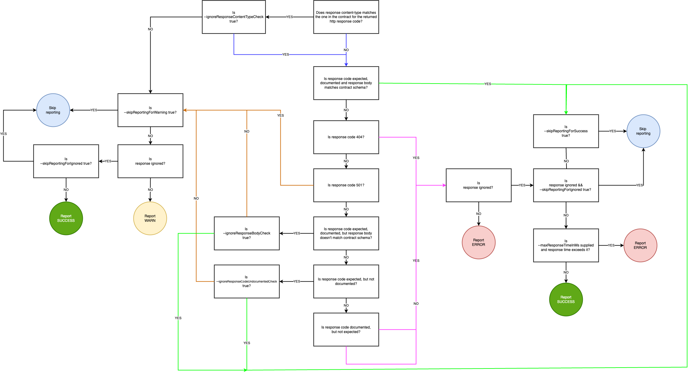

# How CATS Works

CATS generates tests based on configured Fuzzers. Each Fuzzer tests a specific scenario and has a specific expected result.
The CATS engine will run the scenario, get the result from the service and match it with the Fuzzer expectations.

Depending on the matching outcome, CATS will report as follows:

- `info`/`success` is expected and documented behaviour. No need to be actioned.
- `warn` is expected but undocumented behaviour or some misalignment between the contract and the service. This will **ideally** be actioned.
- `error` is abnormal/unexpected behaviour. This **must** be actioned.

What data goes into the report is also influenced by the arguments supplied, particularly `--ignoreXXX` arguments. 
The below diagram shows all decision points that are considered when reporting a test case:

CATS will iterate through **all endpoints**, **all HTTP methods** and **all the associated requests bodies and parameters** (including multiple combinations when dealing with `oneOf`/`anyOf` elements) 
and fuzz their values considering their defined data type and constraints.
The actual fuzzing depends on the specific Fuzzer executed. Please check the [list of fuzzers](/docs/fuzzers) for the specific behaviour.

There are also differences on how the fuzzing works depending on the HTTP method:
- for methods with request bodies like **POST, PUT, PATCH** the fuzzing will be applied at the **request body data models level** (supporting `application/json`, `*+json`, `application/x-www-form-urlencoded`, `text/plain`, and `application/x-ndjson` / `application/ndjson`)
- for methods without request bodies like **GET, DELETE, HEAD** (and **TRACE** when explicitly enabled via `--httpMethods`) the fuzzing will be applied at the **URL parameters level**

When [runtime resource reuse](../advanced-topics/runtime-resource-reuse) is enabled (the default), CATS orders root collection `POST` producers before dependent paths, executes fuzzers in breadth-first waves across paths (seeding resources with `HappyPath` and `OnlyRequiredFields` first, followed by coverage, crash, remaining first-phase, and second-phase fuzzers), and postpones `HappyPath` `DELETE` requests until all paths have been fuzzed so learned identifiers remain valid throughout the run.

:::note
For HTTP methods with request bodies (`POST, PUT, PATCH`) that also have URL/path parameters, CATS automatically attempts to resolve path parameters from earlier `2XX` responses in the run. When an identifier cannot be learned at runtime, supply it via [`--urlParams`](url-params) or the [`--refData`](reference-data-file) file.
:::