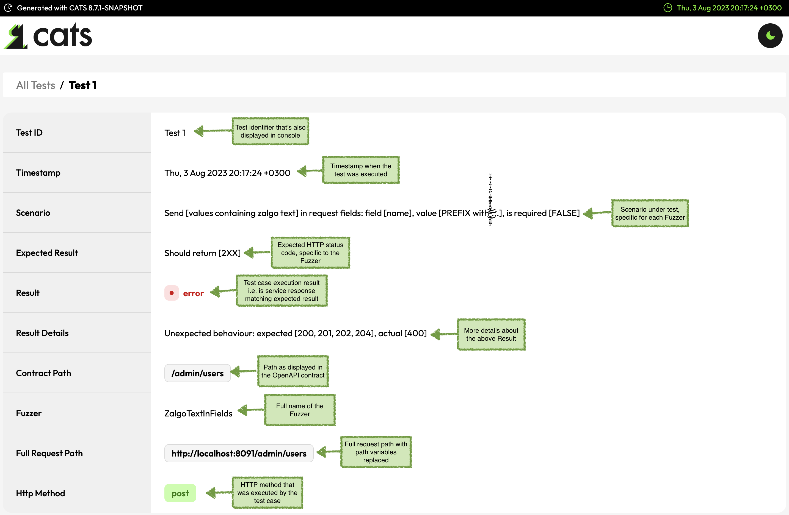
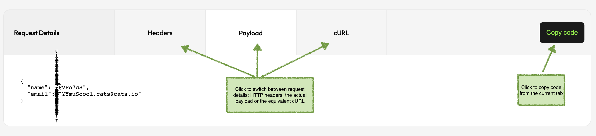

# Interpreting Results

Open `cats-report/index.html` to review the run. Both HTML formats include
**All tests** and **Problems**.

## Problems

A problem groups errors and warnings that share the same oracle evidence. Each
problem lists its occurrences by operation and links to example tests. Review
the observed HTTP outcome and the server's example message. The masked pattern
used for grouping appears under **How these tests were grouped**. A pattern
can cover multiple responses, so use the linked test to inspect the full
exchange.

CATS persists the problem catalog, problem IDs, and key version in
`cats-summary-report.json`. Test records hold `expectedResponseCodes` and
`expectedOutcome` where an effective HTTP expectation is available. These
fields reflect the oracle after configuration overrides. Older test evidence
can display its saved expectation text.

## HTML_JS

`HTML_JS` is the default report. **All tests** opens first and renders
progressively for large runs. Search and result filters operate on the complete
dataset. Open any test to review its scenario, expectation, verdict, and
request and response. Use the summary JSON for automated processing.

:::tip
You can change `cats-report` to something else using the `-o` argument. `cats ... -o /tmp/reports` will write the CATS report in the `/tmp/reports` folder.
:::

:::note
Please note that Javascript might not play well with the CI servers. 
You may choose the non-JS version when embedding the report into a CI pipeline.
:::

Along with the summary from `index.html` each individual test will have a specific `TestXXX.html` page with more details.

:::tip
Individual tests are also written as JSON files. This is useful when you want to replay a test using `cats replay TestXXX`. 
Tests can be uploaded as test evidence and be later reproduced/verified.
:::

Understanding the `Result Reason` values:
- `Unexpected Exception` - reported as `error`; this indicates a possible bug in the service or a corner case that is not handled correctly by CATS
- `Not Matching Response Schema` - reported as a `warn`; this indicates that the service returns an expected response code and a response body, but the response body does not match the schema defined in the contract (validated using full OpenAPI 3.0/3.1 JSON Schema validation, including format assertions and `$ref` resolution, unless `--ignoreResponseBodyCheck` / `--ib` is set)
- `Undocumented Response Code` - reported as a `warn`; this indicates that the service returns an expected response code, but the response code is not documented in the contract
- `Unexpected Response Code` - reported as an `error`; this indicates a possible bug in the service - the response code is documented, but is not expected for this scenario
- `Unexpected Behaviour` - reported as an `error`; this indicates a possible bug in the service - the response code is neither documented nor expected for this scenario
- `Not Found` - reported as an `error` in order to force providing more context; this indicates that CATS needs additional business context in order to run successfully - you can do this using the `--refData` and/or `--urlParams` arguments
- `Response time exceeds max` - reported as an `error` if the `--maxResponseTimeInMs` is supplied and the response time exceeds this number
- `Response body truncated` - reported as `warn` when a response body exceeds `--maxResponseBytes` (default `10485760` bytes) and is truncated before body-dependent checks can complete
- `Rate limited` indicates that throttling exhausted the retry budget and prevented a conclusive verdict. See [Request pacing and rate limiting](running-cats.md#request-pacing-and-rate-limiting).
- `Call timeout exceeded` - reported as `error` when an HTTP call exceeds the configured `--callTimeout` budget (response code `959`)
- `Response content type not matching the contract` - reported as `warn` if the content type received in response does not match the one defined in the contract for the received http response code
- `Error details leak` - reported as `error` if the response body contains sensitive information
- `Not Implemented` - reported as `warn` if response code is `501`
- `Mass Assignment vulnerability detected` - reported as `error` if the service allows mass assignment (including `ReadOnlyFieldsMassAssignmentFuzzer` when a `readOnly: true` field sent in a write request is accepted and reflected)
- `Path traversal vulnerability detected` - reported as `error` by `PathTraversalInStringFieldsFuzzer` when a response discloses local file content (such as `/etc/passwd`, `win.ini`, or `/proc/self/environ`) or leaks unmasked filesystem exception paths
- `HTTP method override accepted` - reported as `error` by `HttpMethodOverrideTunnelingFuzzer` when a `POST` carrying an HTTP method-override header (`X-HTTP-Method-Override`, `X-Method-Override`, `X-HTTP-Method`) executes an undocumented verb such as `DELETE`
- `Inconsistent arithmetic total accepted` - reported as `error` by `ArithmeticTotalMismatchFieldsFuzzer` when a write request with a contradicting total (such as `unitPrice * quantity != totalAmount`) is accepted with `2XX` and reflects the tampered total
- `Path and body ID mismatch accepted` - reported as `error` by `PathBodyIdMismatchFuzzer` when a write request whose top-level body identifier contradicts the URL `{path}` identifier is accepted with `2XX` and reflects the mismatched body identifier
- `PATCH wiped omitted optional fields` - reported as `warn` by `PatchOmittedFieldsClobberFuzzer` when a partial `PATCH` omitting a previously populated optional field causes that field to become `null`, blank, or missing on a subsequent `GET`
- `Pagination limit ignored` - reported as `warn` by `PaginationLimitHonoredFuzzer` when a `GET` collection request specifying `limit=1` (or `size=1` / `pageSize=1` / `per_page=1`) returns more than `1` item
- `Server error with injection payload` - reported as `error` if the service returns a server error for an injection payload
- `SSRF payload reflected in response` - reported as `error` if the service is vulnerable to SSRF attacks
- `Cloud metadata service accessed` - reported as `error` if the service leaks cloud metadata
- `File content exposed via SSRF` - reported as `error` if the service leaks file content via SSRF
- `Sensitive data leak` - reported as `error` if the service leaks sensitive data
- `Network error reveals SSRF attempt` - reported as `error` if the service is vulnerable to SSRF attacks
- `DNS resolution error reveals SSRF attempt` - reported as `error` if the service is vulnerable to SSRF attacks
- `HTTP client error reveals SSRF attempt` - reported as `error` if the service is vulnerable to SSRF attacks
- `Internal target reflected in response` - reported as `error` if the service is vulnerable to SSRF attacks
- `Missing recommended security headers` - reported as `error` if the http response does not have the recommended security headers
- `Missing response headers` - reported as `error` if the http response does not contain all the headers defined in the contract
- `Heuristic IDOR signal detected` - reported as `error` when a request with a modified identifier returns `2XX` and the response contains the alternative identifier
- `Server error with IDOR payload` - reported as `error` if the service returns `5XX` for an IDOR payload
- `WriteOnly fields exposed in response` - reported as `error` by `SensitiveDataExposureFuzzer` when a response contains fields marked `writeOnly` in the OpenAPI contract
- `Sensitive data exposed in response` - reported as `warn` by `SensitiveDataExposureFuzzer` when a response contains undeclared fields with sensitive names (such as `password`, `secret`, or `apiKey`) and unmasked values
- `Read broken after fuzzing` - reported as `error` by `CheckReadsStillWorkFuzzer` when an operation that returned `2XX` for unmodified requests earlier in the run returns a `5XX` server error after the path was fuzzed
- `PUT retry caused server error`, `PUT retry rejected`, `PUT retry broke resource read`, `PUT is not idempotent` - reported by `PutIdempotencyFuzzer` when repeating an identical `PUT` fails or changes stable resource state
- `Possible update/read inconsistency` - reported as `warn` by `UpdateReadConsistencyFuzzer` when writable primitive fields sent in a successful `PUT`/`PATCH` differ on a subsequent `GET`
- `Stale If-Match accepted`, `Stale If-Match caused server error`, `Conditional GET ignored`, `Conditional GET caused server error` - reported by `ConditionalEtagFuzzer` when `If-None-Match` or stale `If-Match` preconditions are ignored or cause `5XX` errors
- `Created resource unavailable` - reported as `warn` by `CreatedResourceLocationFuzzer` when a `POST` `201` `Location` returns `404` or `410` on `GET`
- `Potential cross-parent resource exposure`, `Cross-parent request caused server error` - reported by `CrossParentResourceIsolationFuzzer` when a child resource is exposed or causes `5XX` under a swapped parent ID
- `Empty reply from server`, `Connection refused`, `Read timeout`, `Write timeout`, `Connection timeout`, `HTTP protocol exception`, `Connection reset` - explicit I/O error reasons corresponding to `9XX` communication codes

The following examples show the request, response, and result sections of an individual test page.




You can generate multiple report formats in a single run by passing a comma-separated list to `--reportFormat` (for example `--reportFormat HTML_JS,JUNIT,WFC_REPORT`).

## HTML_ONLY

`HTML_ONLY` provides a pre-rendered test table and Problems view without
JavaScript filtering or sorting.

## JUNIT
CATS also supports [JUNIT](https://llg.cubic.org/docs/junit/) output. The output will contain one `testsuite` per fuzzer. Each test run by that fuzzer will be recorded as a `testcase`.
As the JUNIT format does not have the concept of `warning` the following mapping is used:

- CATS `error` with valid HTTP codes are mapped as JUNIT `failure`
- CATS `error` with code 9XX are mapped as JUNIT `error`
- CATS `warn` is reported as JUNIT `skipped` and message starting with `WARN - `

The JUNIT report is written as `junit.xml` in the `cats-report` folder. Individual tests, both as `.html` and `.json` will also be created.

## WFC_REPORT
`WFC_REPORT` generates a standardized Web Fuzzing Commons `report.json` file in the report directory, mapping CATS findings to official WFC `DefinedFaultCategory` constants and `CatsWfcFaultCategory` sub-categories, suitable for cross-fuzzer benchmarking and WFC-compatible tooling. When an OpenAPI contract is available, WFC endpoint IDs and coverage use its declared operations. Eligible faults from synthetic methods can be attributed to a declared operation on the same path. See the [16.0.0 migration guide](../upgrading-to-16.md#wfc-exports) for changed category IDs.

WFC also checks observed `401` and `403` responses against the operation's
declared security and response codes. For HTTP `500`, fault context can use
a normalized error template extracted from the structured response body.

:::tip
If you want to have history for CATS runs you can use the `--timestampReports` argument. This will create sub-folders for each run within the `cats-reports` folder with the corresponding timestamp.
:::

## Triaging Reports & Verifying Fixes (`cats triage`)

Run `cats triage` (aliases `diagnose`, `doctor`) to review persisted problems, export remediation artifacts, or verify fixes. Triage includes errors and warnings by default. Use `--errors-only` for errors alone.

```bash
# Review problems and export remediation artifacts
cats triage -r cats-report -c openapi.yml \
  --export-refdata refData.yml \
  --export-correlations correlations.yml \
  --export-contract-patch contract-patch.yml \
  --export-reproducers reproducers.sh

# Replay one representative request per occurrence against the live server
export Authorization='Bearer eyJ...'
cats triage -r cats-report --verify -s http://localhost:8080
```

Triage presents observations and the next check based on recorded evidence.
Live verification reports `FIXED`, `STILL_FAILING`, or `INCONCLUSIVE`.
With `--verify`, an unresolved server-error occurrence produces exit code `1`.
Use `--show-reproducers` to print full curl commands in the console. JSON
(`-j`) and `--export-reproducers` include those commands by default.

Keep the summary and referenced `Test*.json` files together. Triage rejects
incompatible or incomplete reports with exit code `2`.

:::tip Keep successful exchanges and warnings when collecting evidence
Retain `2XX` producer exchanges for `--export-refdata` and stateful replay.
Run in ordinary reporting mode and omit `--srs`, `--srw`, and `-k` when you
need the full evidence for triage.
:::

## Execution summary

Recent reports also include the active fuzzer profile (`--profile`), configured
quality-gate status, stop-condition status, and execution summaries. A run can
stop before all generated tests are executed because of `--stopAfterTests`,
`--stopAfterErrors`, or `--stopAfterTimeInSec`; tests already executed remain
included in the summary.
