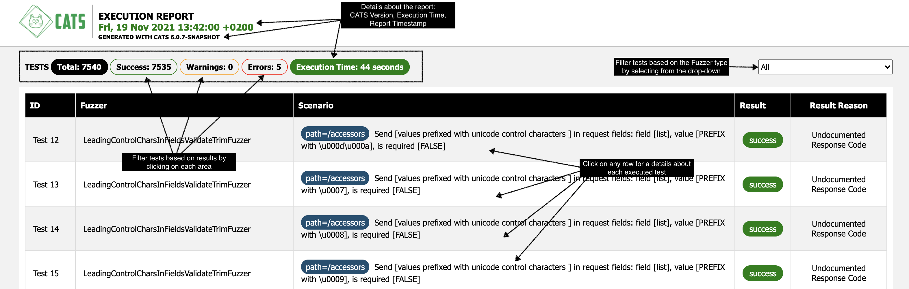
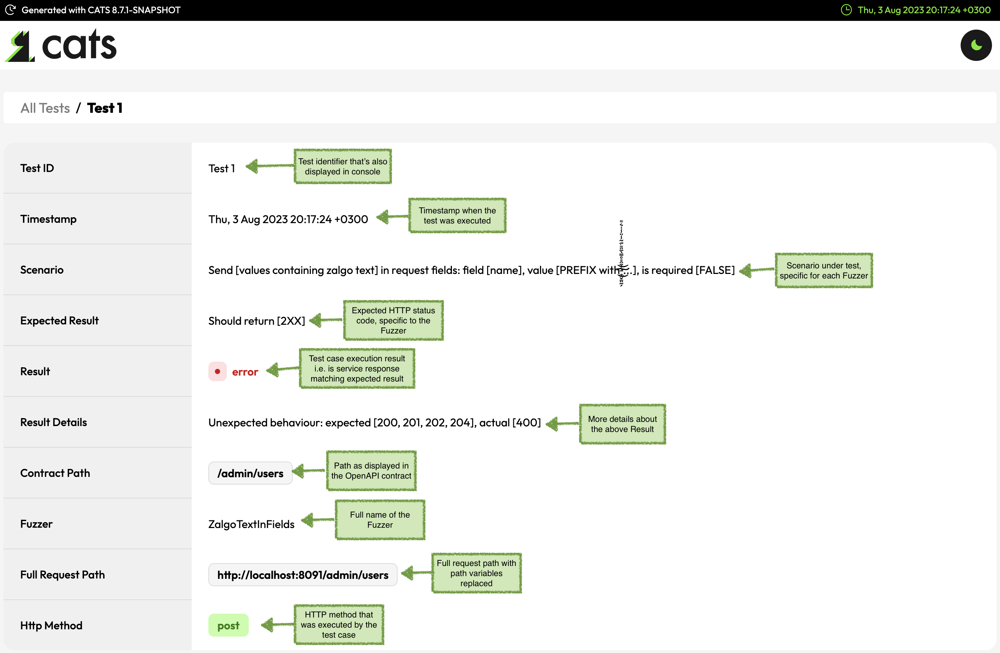
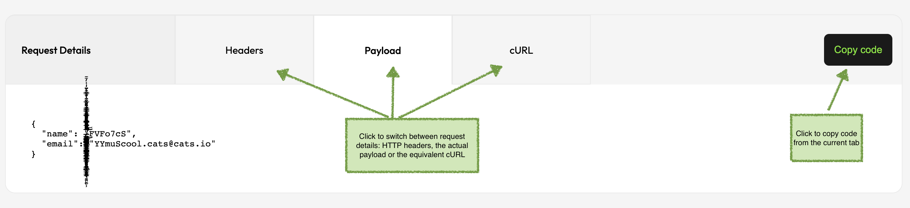

# Interpreting Results

This is a typical CATS report summary page:

## HTML_JS
`HTML_JS` is the default report produced by CATS. It has Javascript enabled in order to have some interaction with the reports.
The execution report is placed in a folder called `cats-report` which is created inside the current folder. 
Opening the `cats-report/index.html` file, you will be able to:

- filter tests based on the result: `All`, `Success`, `Warn` and `Error`
- omni-search box to be able to search by any string without the summary table
- see summary with all the tests with their corresponding path against they were run, and the result
- have ability to click on any tests and get details about the Scenario being executed, Expected Result, Actual result as well as request/response details

:::tip
You can change `cats-report` to something else using the `-o` argument. `cats ... -o /tmp/reports` will write the CATS report in the `/tmp/reports` folder.
:::

:::note
Please note that Javascript might not play well with the CI servers. 
You may choose the non-JS version when embedding the report into a CI pipeline.
:::

Along with the summary from `index.html` each individual test will have a specific `TestXXX.html` page with more details.

:::tip
Individual tests are also written as JSON files. This is useful when you want to replay a test using `cats replay TestXXX`. 
Tests can be uploaded as test evidence and be later reproduced/verified.
:::

Understanding the `Result Reason` values:
- `Unexpected Exception` - reported as `error`; this indicates a possible bug in the service or a corner case that is not handled correctly by CATS
- `Not Matching Response Schema` - reported as a `warn`; this indicates that the service returns an expected response code and a response body, but the response body does not match the schema defined in the contract (validated using full OpenAPI 3.0/3.1 JSON Schema validation, including format assertions and `$ref` resolution, unless `--ignoreResponseBodyCheck` / `--ib` is set)
- `Undocumented Response Code` - reported as a `warn`; this indicates that the service returns an expected response code, but the response code is not documented in the contract
- `Unexpected Response Code` - reported as an `error`; this indicates a possible bug in the service - the response code is documented, but is not expected for this scenario
- `Unexpected Behaviour` - reported as an `error`; this indicates a possible bug in the service - the response code is neither documented nor expected for this scenario
- `Not Found` - reported as an `error` in order to force providing more context; this indicates that CATS needs additional business context in order to run successfully - you can do this using the `--refData` and/or `--urlParams` arguments
- `Response time exceeds max` - reported as an `error` if the `--maxResponseTimeInMs` is supplied and the response time exceeds this number
- `Response body truncated` - reported as `warn` when a response body exceeds `--maxResponseBytes` (default `10485760` bytes) and is truncated before body-dependent checks can complete
- `Call timeout exceeded` - reported as `error` when an HTTP call exceeds the configured `--callTimeout` budget (response code `959`)
- `Response content type not matching the contract` - reported as `warn` if the content type received in response does not match the one defined in the contract for the received http response code
- `Error details leak` - reported as `error` if the response body contains sensitive information
- `Not Implemented` - reported as `warn` if response code is `501`
- `Mass Assignment vulnerability detected` - reported as `error` if the service allows mass assignment
- `Server error with injection payload` - reported as `error` if the service returns a server error for an injection payload
- `SSRF payload reflected in response` - reported as `error` if the service is vulnerable to SSRF attacks
- `Cloud metadata service accessed` - reported as `error` if the service leaks cloud metadata
- `File content exposed via SSRF` - reported as `error` if the service leaks file content via SSRF
- `Sensitive data leak` - reported as `error` if the service leaks sensitive data
- `Network error reveals SSRF attempt` - reported as `error` if the service is vulnerable to SSRF attacks
- `DNS resolution error reveals SSRF attempt` - reported as `error` if the service is vulnerable to SSRF attacks
- `HTTP client error reveals SSRF attempt` - reported as `error` if the service is vulnerable to SSRF attacks
- `Internal target reflected in response` - reported as `error` if the service is vulnerable to SSRF attacks
- `Missing recommended security headers` - reported as `error` if the http response does not have the recommended security headers
- `Missing response headers` - reported as `error` if the http response does not contain all the headers defined in the contract
- `Heuristic IDOR signal detected` - reported as `error` when a request with a modified identifier returns `2XX` and the response contains the alternative identifier
- `Server error with IDOR payload` - reported as `error` if the service returns `5XX` for an IDOR payload
- `WriteOnly fields exposed in response` - reported as `error` by `SensitiveDataExposureFuzzer` when a response contains fields marked `writeOnly` in the OpenAPI contract
- `Sensitive data exposed in response` - reported as `warn` by `SensitiveDataExposureFuzzer` when a response contains undeclared fields with sensitive names (such as `password`, `secret`, or `apiKey`) and unmasked values
- `Read broken after fuzzing` - reported as `error` by `CheckReadsStillWorkFuzzer` when an operation that returned `2XX` for unmodified requests earlier in the run returns a `5XX` server error after the path was fuzzed
- `PUT retry caused server error`, `PUT retry rejected`, `PUT retry broke resource read`, `PUT is not idempotent` - reported by `PutIdempotencyFuzzer` when repeating an identical `PUT` fails or changes stable resource state
- `Possible update/read inconsistency` - reported as `warn` by `UpdateReadConsistencyFuzzer` when writable primitive fields sent in a successful `PUT`/`PATCH` differ on a subsequent `GET`
- `Stale If-Match accepted`, `Stale If-Match caused server error`, `Conditional GET ignored`, `Conditional GET caused server error` - reported by `ConditionalEtagFuzzer` when `If-None-Match` or stale `If-Match` preconditions are ignored or cause `5XX` errors
- `Created resource unavailable` - reported as `warn` by `CreatedResourceLocationFuzzer` when a `POST` `201` `Location` returns `404` or `410` on `GET`
- `Potential cross-parent resource exposure`, `Cross-parent request caused server error` - reported by `CrossParentResourceIsolationFuzzer` when a child resource is exposed or causes `5XX` under a swapped parent ID
- `Empty reply from server`, `Connection refused`, `Read timeout`, `Write timeout`, `Connection timeout`, `HTTP protocol exception`, `Connection reset` - explicit I/O error reasons corresponding to `9XX` communication codes

This is what you get when you click on a specific test:

You can generate multiple report formats in a single run by passing a comma-separated list to `--reportFormat` (for example `--reportFormat HTML_JS,HTML_JS_CLUSTERS,JUNIT,WFC_REPORT`).

## HTML_JS_CLUSTERS
`HTML_JS_CLUSTERS` generates an interactive clustered HTML report (`index.html`) that groups failing and warning tests into root-cause clusters using response status, JSON error-message extraction, and response similarity (including `2XX` validation errors).

## HTML_ONLY
This format is similar with `HTML_JS`, but you cannot do any filtering or sorting. This is more suitable when embedding the CATS report into a CI pipeline.

## JUNIT
CATS also supports [JUNIT](https://llg.cubic.org/docs/junit/) output. The output will contain one `testsuite` per fuzzer. Each test run by that fuzzer will be recorded as a `testcase`.
As the JUNIT format does not have the concept of `warning` the following mapping is used:

- CATS `error` with valid HTTP codes are mapped as JUNIT `failure`
- CATS `error` with code 9XX are mapped as JUNIT `error`
- CATS `warn` is reported as JUNIT `skipped` and message starting with `WARN - `

The JUNIT report is written as `junit.xml` in the `cats-report` folder. Individual tests, both as `.html` and `.json` will also be created.

## WFC_REPORT
`WFC_REPORT` generates a standardized Web Fuzzing Commons `report.json` file in the report directory with WFC fault classification (`CatsWfcFaultCategory`), suitable for cross-fuzzer benchmarking and WFC-compatible tooling.

:::tip
If you want to have history for CATS runs you can use the `--timestampReports` argument. This will create sub-folders for each run within the `cats-reports` folder with the corresponding timestamp.
:::

## Execution summary

Recent reports also include the configured quality-gate status, stop-condition
status, and execution summaries. A run can stop before all generated tests are
executed because of `--stopAfterTests`, `--stopAfterErrors`, or
`--stopAfterTimeInSec`; tests already executed remain included in the summary.
